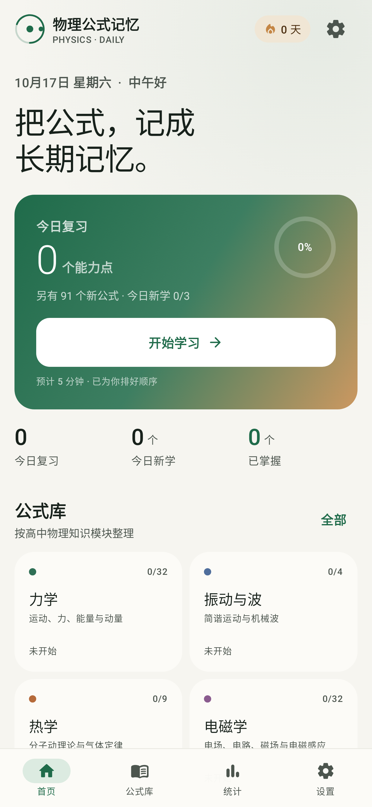
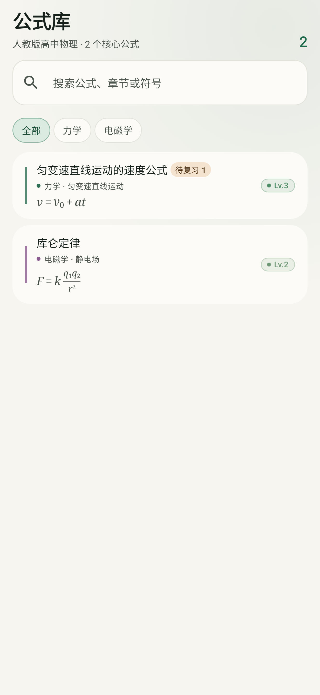
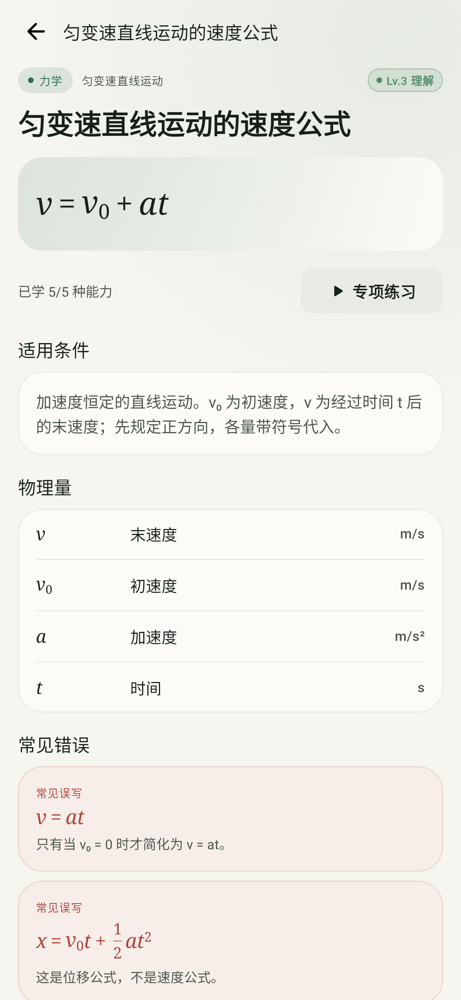

# PhysCard · 物理公式记忆

面向高中生的离线物理公式记忆 App。用类似背单词的节奏，通过五类选择题复习高中物理公式，并由官方 FSRS 实现计算下一次复习时间。

## 产品概览

应用名称：**物理公式记忆**（PhysCard）。

- **91 个高中物理核心公式**，覆盖力学、振动与波、热学、电磁学、光学、近代物理六个模块，共 **1365 道选择题**（每个公式每种能力各 3 道）。
- **五类考查能力**独立维护复习状态：完整公式、公式填空、公式变形、适用条件、易混辨析。
- **官方 FSRS 调度**：`io.github.open-spaced-repetition:fsrs:1.0.0`（java-fsrs，MIT），目标保持率默认 90%，可在设置中调整。
- **八级记忆等级**独立于 FSRS，只作为成长反馈，不会覆盖 FSRS 计算出的复习日期。
- **完全离线**：内置 Room 数据库、JSON 题库、公式排版引擎；没有网络权限、账号系统、广告或分析 SDK。
- 浅色 / 深色 / 跟随系统，公式使用原生 Compose 排版。
- 支持题库 JSON 导入/导出、重复检测、格式校验和明确的错误提示。

## 界面

| 首页 | 公式库 | 公式详情 |
| --- | --- | --- |
|  |  |  |

## 构建与运行

环境：

- JDK 17（项目使用 Java 17 toolchain / desugaring）
- Android SDK Platform 35、Build Tools 35
- Gradle Wrapper 8.10.2，首次构建需要联网下载依赖


### 每日学习

首页把“到期能力卡”和“新公式”合并成一组学习任务。每个新公式会建立 5 张能力卡，首次学习依次展示公式卡与五类题目；之后各能力按 FSRS 独立到期。

学习流程严格分离两个信息维度：

1. 点击选项，系统立即判断对错，并展示解释、标准公式、适用条件和常见错误；
2. 再根据真实回忆体验选择 **忘记 / 困难 / 记得 / 熟练**；
3. FSRS 根据卡片状态、复习历史和该评价计算下次到期时间；
4. 系统在同一事务中写入复习状态与复习日志；即使立即杀掉应用，已提交的卡片也不会丢失。

答错不会被伪装成“已掌握”：等级策略在答错时永远不会增加可见进度，但也不会清空全部历史；单次遗忘最多下降一级。

### 八级等级

`MemoryLevelPolicy` 是独立配置层，阈值、复习次数门槛、稳定性门槛和单次升降规则都可调整：

| 等级 | 名称 | 大致含义 |

| Lv.1 | 初识 | 刚刚建立印象 |

| Lv.2 | 熟悉 | 能辨认基本形状 |

| Lv.3 | 理解 | 理解物理量关系 |

| Lv.4 | 掌握 | 能独立完成常见回忆 |

| Lv.5 | 稳固 | 多次正确，记忆稳定 |

| Lv.6 | 熟练 | 不同题型都能应对 |

| Lv.7 | 精通 | 长期保持并可迁移 |

| Lv.8 | 贯通 | 接近长期记忆 |


等级由积分、复习次数、FSRS 稳定性和正确率共同门控；一次答对不可能直接跳到高等级。
### 安装包构建与归档

- 最新版固定产出在 `app/build/outputs/apk/release/PhysCard.apk`（文件名不带版本号）。
- 每次构建前，旧的 `PhysCard.apk` 会被移到 `version history/`，按它自身的版本号重命名为 `PhysCard-v<版本号>.apk`；同版本已存在时不覆盖。
- 归档目录只放旧版本，最新版不归档；debug 包不参与这套流程。

```powershell
powershell -ExecutionPolicy Bypass -File "D:\PhysCard\version history\build-release.ps1"
```

### 数据与题库

- Room 表：公式、题目、题目选项、答案、每种能力的复习状态、复习日志。
- 答案单独存放在 `question_answers` 表，题目与选项、答案分离，便于检查与维护。
- 内置题库位于 `app/src/main/assets/`：`modules.json`、`formulas.json`、`questions.json`。
- 题库源文件与校验器位于 `tools/`；修改后运行：

```bash
python tools/generate_seed.py
```

生成器会校验重复 ID、缺失题目类型、重复选项、空字段和答案越界等问题。

### 导入 / 导出

设置页可通过系统文件选择器导出/导入 JSON。导出文件结构：

```json
{
  "schemaVersion": 1,
  "appVersion": "1.5.0",
  "exportedAt": "2026-10-17T00:00:00Z",
  "formulas": [ ... ],
  "questions": [ ... ]
}
```

导入时会校验 schema、模块、公式引用、选项数量、答案下标和重复项；已存在的公式或题目会被跳过并报告数量，不会覆盖学习进度。格式错误会显示明确原因。

### 时间与时区

- 调度时间以 UTC `Instant` 持久化；展示时使用设备当前时区。
- “今天”、连续天数、最近 7 天等日历统计根据 `reviewedAt` 与当前时区重新计算，避免旅行换时区后把历史归错日期。
- FSRS 的间隔由官方库计算；本地日期不参与下一次到期时间的计算。

## 技术栈

| 层 | 选择 |
| --- | --- |
| UI | Kotlin + Jetpack Compose + Material 3 |
| 架构 | MVVM + Repository + 单向数据流 |
| 本地数据 | Room 2.6.1 + DataStore Preferences |
| 调度 | 官方 java-fsrs 1.0.0（FSRS-5） |
| 公式渲染 | 自研 Compose TeX 子集解析器 |
| 异步 | Kotlin Coroutines / Flow |
| 测试 | JUnit、Robolectric、Compose UI Test、Room |


## 数据来源与内容边界

公式内容依据人民教育出版社《普通高中教科书·物理》（2019 版）必修第一、二、三册和选择性必修第一、二、三册的知识体系整理，按教材章节组织。具体章节映射、公式清单和题目设计见 [docs/CONTENT.md](docs/CONTENT.md)。

内容边界：

- 本应用是复习工具，不替代教材、教师讲解和实验；
- 一部分推导公式（例如由基本公式直接变形得到的中间式）没有单独建卡，以核心公式和高考常见关系为主；
- 公式、条件、单位经过人工整理与自动校验，但物理表述仍建议以教材为准；发现错误可通过导出 JSON 检查并在维护流程中修正。

## 测试

当前测试覆盖：

- 公式解析：内置 91 个公式、全部题目 LaTeX、分式/根号/上下标；
- FSRS：官方调度器初始化、四档预览、Again 重新学习、UTC 时区无关性；
- 等级：单次正确不跳级、连续复习逐步升级、单次遗忘最多降一级、Lv.8 需要长期稳定性；
- Room/内容：首次播种 91 个公式、1365 道题、455 个能力状态；每日会话、评分持久化、重启后剩余能力；
- 导入/导出：重复导入幂等、自定义题库新增、格式错误提示；
- UI：首页、公式库、详情、统计、设置、学习反馈、总结的 Robolectric 截图与端到端流程（启动 → 开始学习 → 作答 → 评分 → 下一题）。

```bash
./gradlew :app:testDebugUnitTest
```

## 许可证

应用代码采用 MIT License，见 [LICENSE](LICENSE)。第三方组件许可见 [NOTICE.md](NOTICE.md)。
